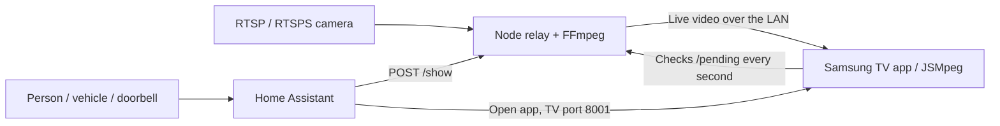

# Camera Overlay for Samsung TVs

Show a live camera as a small picture-in-picture over what you're watching on a **Samsung Tizen TV**, such as Sky or another box on HDMI. Home Assistant decides when it appears. It closes after your chosen time or when you press BACK, and the HDMI programme carries on underneath, sound included.

> **This is the Samsung Tizen branch** of [LG Camera Overlay](https://github.com/mbsintegrations/LG-Camera-Overlay) by MBS Integrations. The LG webOS version, with its setup wizard, release downloads and test record, lives on that project's `main` branch. This branch shares its relay, Home Assistant blueprints and 1.2.0 features, and adds a Samsung TV app.

## What it does

- Shows a live camera in a picture-in-picture over the HDMI input, with the seconds remaining in its corner. The TV stays on that input, and its sound carries on.
- Lets Home Assistant show the camera from a dashboard button or an automation, such as a person detection or doorbell press.
- Closes after the chosen time, counted from when the picture appears, or when you press BACK on the Samsung remote.
- Lets you set the picture's position (any corner or the centre), size, distance from the edge, border and colour, and an optional camera label, all from Home Assistant without rebuilding anything.
- Works with the project's alert automation (cooldown, doorbell priority) and its shared **Pause camera overlays** switch, including pausing on a schedule.

## What you need

- **A Samsung Tizen TV** with your box on an HDMI input. Apps built into the TV (Netflix on the Samsung itself) can't be overlaid. See [compatibility](#compatibility).
- **Home Assistant**, with its built-in **Samsung Smart TV** integration. No HACS integration is needed.
- **A camera or recorder with an RTSP/RTSPS stream**, and its username and password. For automatic alerts, a detection or doorbell signal must also reach Home Assistant. See [how detections work](docs/DETECTION-FLOW.md).
- **An always-on computer for the relay,** which converts the camera stream for the TV. A Raspberry Pi works, and it can be the one running Home Assistant. See [hosting](docs/HOSTING.md).
- **A Mac or PC with Tizen Studio** and a **Samsung account**, to build and install the TV app once. You need them again to rebuild it or renew the certificate.

**[Start here: Samsung installation guide](docs/SAMSUNG-TIZEN.md)** · [Choose your setup](docs/START-HERE.md) · [Installation reference](docs/INSTALL.md) · [Home Assistant setup](docs/HOME-ASSISTANT.md) · [Troubleshooting](docs/TROUBLESHOOTING.md) · [Test results](docs/VALIDATION.md)

## How it works

Samsung doesn't let apps draw over other apps. Instead, the overlay app runs full-screen and uses Samsung's TVWindow API to keep the HDMI input playing **behind** a transparent page, with the camera drawn on top.

- **The app stays open between alerts.** When the time is up, the camera disappears and the HDMI picture carries on. Later alerts appear without the TV's app loading screen.
- **Video never goes through Home Assistant.** The relay pulls the camera stream and converts it for the TV. Home Assistant only sends "show this camera" and, if needed, opens the app.
- **The relay starts the camera feed as soon as Home Assistant asks**, and stops it when no TV is watching.

## Compatibility

| Samsung TV | Year | Result |
|---|---|---|
| QE55QN94AATXXU (Neo QLED, `21_NIKEM2_QTV`) | 2021 | Working (user-confirmed), with Sky on HDMI 1, the relay on a Raspberry Pi Zero 2 W and Home Assistant in Docker |

Other models are untested. The TVWindow HDMI-behind-the-page method depends on the model and firmware. Please report your results; the [installation guide](docs/SAMSUNG-TIZEN.md#8-test-without-home-assistant) lists the four checks to run. See [test results](docs/VALIDATION.md) for exactly what has and hasn't been tested.

The relay accepts RTSP/RTSPS camera URLs. Other cameras depend on FFmpeg's support and aren't individually certified. There's no cloud relay or recording. Startup takes a couple of seconds and varies with the camera, network and relay computer. The countdown starts only when the picture appears.

## Security in brief

The TV app talks to the relay over your home network without encryption. The 64-character token in the app and in Home Assistant is the only protection. Keep the relay off the Internet, and keep the token, the built `.wgt` file and the `private/` folder private. See [Privacy and network protection](docs/PRIVACY-AND-NETWORK.md).

## Next steps

See the [Samsung TODO list](TODO.md).

## Project contents

| Path | Purpose |
|---|---|
| `tizen/` | Samsung TV app and the pinned MIT-licensed JSMpeg player |
| `relay/` | Node relay, shared with the LG version |
| `scripts/build-tizen.cjs` | Builds and signs the TV app (`npm run build:tizen`) |
| `blueprints/script/samsung-camera-overlay.yaml` | Home Assistant script blueprint for Samsung TVs |
| `blueprints/automation/` | Alert and pause/resume blueprints, shared with the LG version |
| `config.tizen.example.json`, `compose.tizen.yaml` | Relay configuration example and Docker port override |
| `tests/` | Automated tests, including `tizen-overlay.cjs` and `tizen-relay.cjs` |
| `source/`, `setup/`, `tooling/`, `packaging/` | LG webOS app, setup wizard and packaging, kept from upstream; not used for Samsung |

Own code is **GPL-3.0-only**. Third-party notices remain under their original licences; see [NOTICE](NOTICE) and [licensing](docs/LICENSING.md). Samsung, Tizen, LG, webOS, Sky and Home Assistant are their respective owners' names; this project is independently maintained and not affiliated with them.
