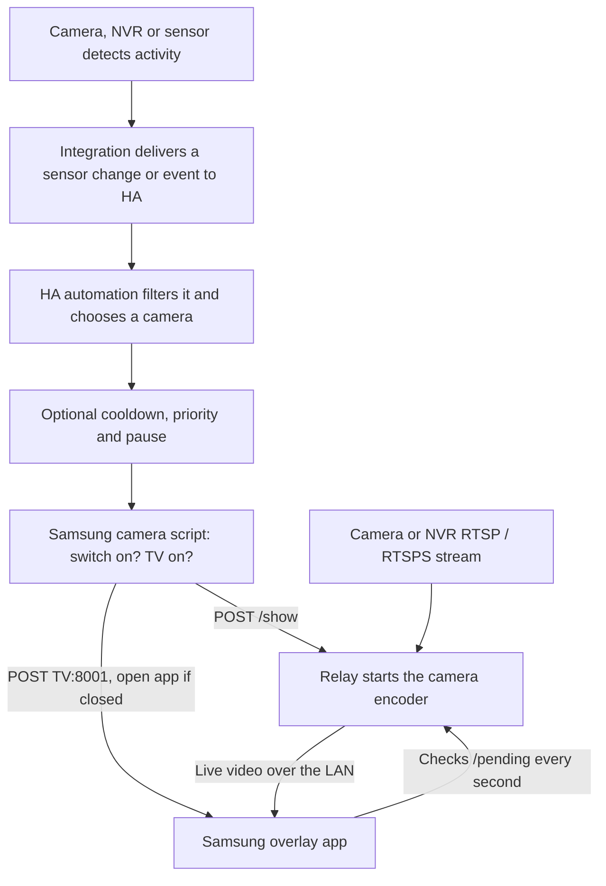

# How a detection becomes a TV overlay

The overlay needs two separate inputs: **a video stream to show** and, for automatic alerts, **a signal telling Home Assistant when to show it**. RTSP/RTSPS supplies the video. It doesn't give this project person detection, zones or doorbell events. A dashboard button can show a camera without any detection at all.

## The two paths on a Samsung TV

1. **Something is detected.** The camera, NVR or a separate sensor decides that something happened. Zones and object recognition belong to that system.
2. **Home Assistant gets a trigger.** Its integration delivers it, for example a binary sensor changing from `off` to `on`, or a doorbell event.
3. **An automation runs.** It decides which camera to show, applies any cooldown, priority or pause, and runs that camera's script. You configure that mapping; a trigger doesn't know which camera you want.
4. **The script checks and asks.** It checks its on/off switch and that the Samsung TV is on, then:
   - sends the relay a "show this camera" request (`/show`) with the label, size, position and duration
   - asks the TV to open the overlay app, which does nothing visible if it's already open
5. **The relay starts converting.** It starts FFmpeg for that camera straight away. The open app picks up the request within a second, connects to the relay and starts playing. The countdown starts at the first frame.
6. **It closes.** When the time is up, or BACK is pressed, the picture disappears and the HDMI input carries on. The app stays open for the next alert. FFmpeg stops when no TV is watching.

Home Assistant never handles the video, and the relay doesn't do any detection.

## Example: UniFi Protect

A typical UniFi setup looks like this. These are example choices, not required names or timings.

| Source | Signal in Home Assistant | Camera shown | Treatment |
|---|---|---|---|
| Front camera | Person **or** vehicle binary sensor, `off` → `on` | Front camera sub-stream | Normal alert |
| Side camera | Person binary sensor, `off` → `on` | Side camera sub-stream | Normal alert |
| Doorbell | The doorbell's `ring` event | Doorbell camera | Priority alert |

With the [alert blueprint](HOME-ASSISTANT.md#add-optional-automatic-alerts):
- the first normal alert shows its camera and starts a cooldown, and further normal alerts during it are ignored
- a doorbell ring bypasses the cooldown
- on a Samsung TV, a ring while a picture is already showing appears after that picture closes, within 60 seconds of the ring, rather than replacing it immediately

The upstream LG project runs this UniFi pattern in its reference installation. **On Samsung, only the manual button has been tested so far.** Detection and doorbell triggers haven't been.

### Zones

Detection zones are configured in the camera system. A camera-level person or vehicle sensor tells Home Assistant *that* something was detected, not *where*. Don't assume a zone used for phone notifications also filters the sensor Home Assistant sees. If you need one zone only, use a sensor or event already limited to that zone, or one whose data includes the zone, and check the real event data first.

### Setting up your own triggers

1. Configure the detection types and zones in your camera system, and enable an RTSP/RTSPS stream separately.
2. Add its Home Assistant integration, for example [UniFi Protect](https://www.home-assistant.io/integrations/unifiprotect/). Find the actual person, vehicle and doorbell entities on the camera's device page.
3. Watch one real detection in **Developer tools → States** or **Events**, and note exactly what changes.
4. Get the manual button working first ([installation guide](SAMSUNG-TIZEN.md)).
5. Add a simple motion automation, or the alert blueprint with trigger IDs. Set the doorbell's trigger ID to exactly `priority`.

## Other camera systems

The relay isn't tied to any brand. It needs an RTSP/RTSPS URL that FFmpeg can decode, with working credentials. Alerts need a usable Home Assistant trigger. **None of these has been tested with this project:**

| Source | What must reach Home Assistant | What you configure |
|---|---|---|
| Another camera or NVR integration | A person, vehicle or motion sensor, or an event | Map that entity or event to a camera script |
| Frigate | Detection or occupancy entities, or filtered events ([Frigate's HA guide](https://docs.frigate.video/integrations/home-assistant/)) | Choose the camera, object and zone, then map it to a script |
| MQTT detector | A message Home Assistant receives, or an MQTT binary sensor ([HA MQTT](https://www.home-assistant.io/integrations/mqtt/)) | Define what the topic and payload mean, and filter the events you want |
| Webhooks only | A Home Assistant webhook trigger | Check the payload fields, and map only known values to your scripts |
| PIR, door contact or doorbell button | Its existing state change or event | Choose a fixed camera to show |
| RTSP-only camera with no detector | Nothing automatic | Use the dashboard button, or add one of the above |

The camera supplying the video and the device triggering it don't have to be the same. A door contact can show the porch camera, for example.

**Avoid false repeats.** With MQTT, make sure retained messages and reconnects aren't treated as new detections. With event streams, tell new detections apart from updates and end events. Never pass a raw event payload into the relay request; map known values to your own predefined scripts.

## Testing the whole chain

Test one stage at a time, so a camera problem isn't mistaken for a trigger problem.

| Test | What to observe |
|---|---|
| Manual button | The camera appears over HDMI, moves, the programme's sound continues, and it closes on time and on BACK |
| Detection you want | The automation trace shows the expected camera chosen |
| Detection you don't want, or outside the zone | No overlay; check the Home Assistant signal, not just the camera app |
| Repeat during cooldown | No second picture; a priority ring still shows after the current picture |
| Pause on, then off | Automatic alerts stop, then resume; buttons still work |
| TV in standby | Nothing happens, and the TV stays off |

## When it fails

- **No detection in the camera system:** check its detection types and zones.
- **Detection there, nothing in Home Assistant:** check the integration, entity availability and permissions.
- **Home Assistant sees it, automation doesn't run:** check the trigger type, the state change, filters and pause.
- **Automation runs, script stops early:** check the script's on/off switch and the TV's state in the trace.
- **Script runs, nothing on the TV:** see [troubleshooting](TROUBLESHOOTING.md).

Keep camera credentials, tokens and raw event data out of public reports.
